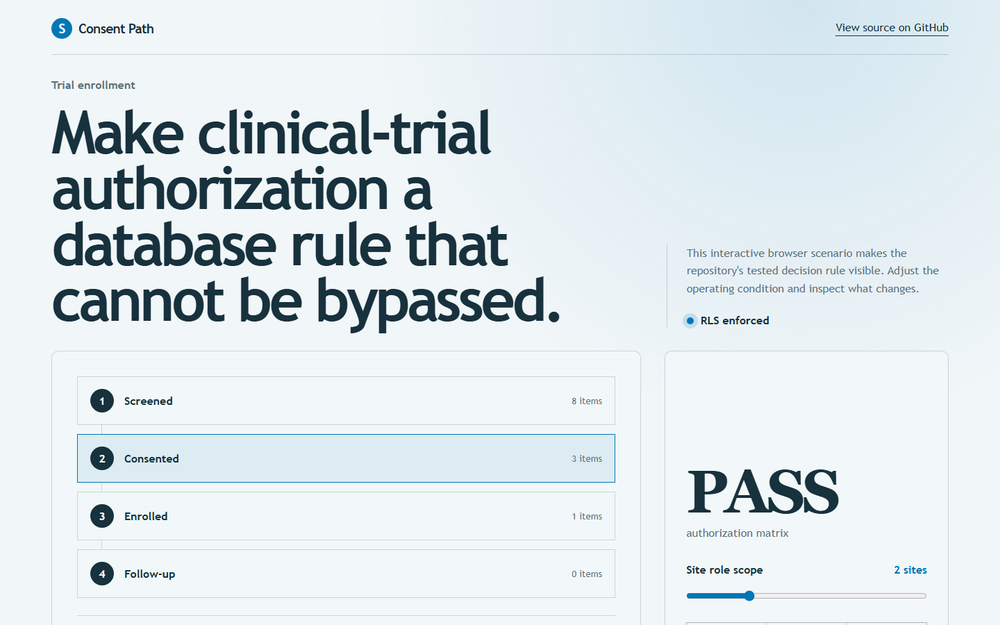
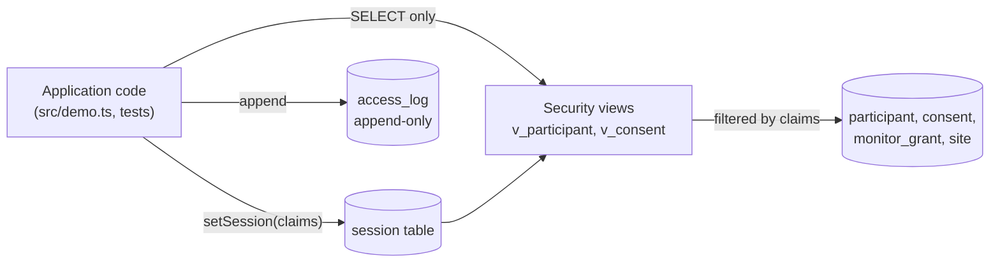

# consentpath

Clinical trial data access where authorisation is decided by the data layer: security views keyed on session claims, with a negative-authorisation test matrix.

[](https://github.com/SlateGitOrg/consentpath/actions/workflows/ci.yml)
[Live demo](https://slategitorg.github.io/consentpath/)



## Why

In a multi-site trial, a coordinator at Site A must never see Site B's participants, and a blinded investigator must never see arm assignment. Most applications enforce this with a site comparison scattered across request handlers, and one forgotten check is a reportable privacy breach. consentpath puts the rules in the data layer, so the application cannot read rows it should not, and proves it by asserting the denials.

## Features

- Site isolation: coordinators, blinded investigators and unblinded statisticians see only their own site.
- Column-level blinding: `arm` is `NULL` unless the role is `UNBLINDED_STATS`.
- Delegated monitor access via `monitor_grant`; the claimed site is ignored.
- Consent-gated export evaluated against the current consent version.
- Append-only access log enforced by triggers.
- A browser demo (`site/`) that evaluates role, site, action and consent for a single request.

## Architecture



The reference design is PostgreSQL row-level security with a low-privilege role and `SET LOCAL` claims. This repo uses `node:sqlite`, which has no RLS, so the same shape is built from a one-row `session` table and views that join against it. The application is only given the views. See [docs/ARCHITECTURE.md](docs/ARCHITECTURE.md).

## Quick start

Requires Node 22.18+ (24 recommended), where TypeScript runs natively via type stripping. There is no install step and no build.

```bash
git clone https://github.com/SlateGitOrg/consentpath.git
cd consentpath
npm test        # 16 tests
npm run demo    # same query, six sessions, different answers
```

## Example

Output of `npm run demo` (trimmed):

```text
  session                        claims     rows  subjects       arm
  c1 COORDINATOR                 SITE_A     2     A-001,A-002    BLINDED
  c2 COORDINATOR                 SITE_B     2     B-001,B-002    BLINDED
  s1 UNBLINDED_STATS             SITE_A     2     A-001,A-002    TREATMENT
  mon1 MONITOR                   SITE_B     2     A-001,A-002    BLINDED
  mon9 MONITOR                   SITE_A     0     -              -

    A-001 genomic export: ALLOWED   (consented CORE+GENOMIC)
    A-002 genomic export: DENIED    (consented CORE only)
```

`mon1` claims SITE_B but is granted SITE_A, and sees SITE_A: the grant decides, not the claim.

## How it works

`v_participant` filters base rows by the session claims and nulls `arm` for roles that may not see it. `v_consent` only exposes consent rows for participants visible in `v_participant`. `exportGenomic` reads the latest consent version, so a re-consent takes effect immediately.

## Testing

`npm test` runs `node --test`: the authorisation suite in `tests/authz-matrix.test.ts` and the demo-site logic in `site/core.test.mjs`. The matrix covers 4 roles x 2 sites x 4 participants (32 cases) and asserts denial as well as permit, so a deny-everything layer fails. Other tests cover the bypass case (an unfiltered `SELECT *` on the view), blinding, monitor grants, consent versioning and the append-only log. CI also runs `scripts/validate_site.py`.

## Project layout

```text
src/store.ts                 schema, security views, session, export gate
src/demo.ts                  the runnable demo
tests/authz-matrix.test.ts   negative-authorisation suite
site/                        browser demo deployed to GitHub Pages
docs/                        architecture notes, screenshots
```

## Limitations

- SQLite stands in for PostgreSQL; there are no real RLS policies, roles or migrations here.
- Isolation relies on the application only being given the views.
- No web application or FHIR data; seed data is a small synthetic set.
- Not HIPAA or GCP certified.

## License

MIT — see [LICENSE](LICENSE).
