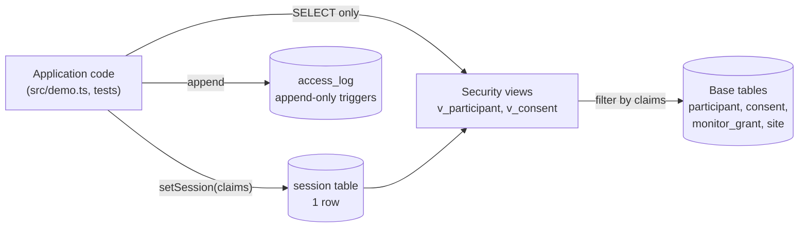

# Architecture

## Context

In a multi-site clinical trial, staff at one site must not see another site's
participants, blinded roles must not see arm assignment, and exports must not
exceed what a participant consented to. Enforcing this with checks in request
handlers fails silently the first time someone forgets one. consentpath moves
the rules into the data layer so that the application cannot express a query
that violates them.

## Container view

The reference design is PostgreSQL row-level security: a low-privilege role,
`SET LOCAL` session claims, and policies on the tables. This repository runs on
`node:sqlite`, which has no RLS, so the same shape is built from a one-row
`session` table and views that join against it. The application is only given
the views.

## Key decisions

- **Policy in the data layer.** Site isolation, delegated monitor access and
  blinding are defined once in `v_participant`. Any query the application
  writes against the view, including an unfiltered `SELECT *`, is constrained.
  Trade-off: the guarantee is only as strong as the rule that the application
  never touches base tables; with PostgreSQL this is enforced by role grants.
- **Blinding as a column rule.** `arm` is `NULL` in the view unless the session
  role is `UNBLINDED_STATS`, so a blinded caller never receives the value.
- **Grants over claims for monitors.** A monitor's visibility comes from
  `monitor_grant`, not from the site they claim in the session.
- **Export checks current consent.** `exportGenomic` reads the latest consent
  version through `v_consent`, so a re-consent takes effect immediately.
- **Append-only log.** `BEFORE UPDATE` and `BEFORE DELETE` triggers abort.

## Failure modes

- A missing or empty session matches no rows (the view returns nothing).
- A role not in the policy list sees nothing.
- Writing to the access log is the caller's responsibility (`logAccess`); it is
  not automatic on read.

## Out of scope

Real PostgreSQL RLS policies and a web application are not implemented here,
and the project is not HIPAA or GCP certified.
